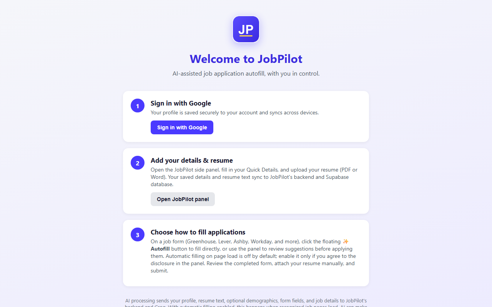

# JobPilot — AI Job Application Autofill

JobPilot is a Chrome extension that uses an LLM to fill out online job applications from your profile and resume. It reads each form's fields, generates answers grounded in your resume and the job description, and writes them into the page. The page can be built with React, shadow DOM, or custom dropdowns.

> **Status:** Version 0.1.2 is submitted to the Chrome Web Store and pending review.
> Store link (active once published): https://chromewebstore.google.com/detail/gnohpngndnfdlbacmbmnoilgeaeljhep



## Features

- **Field matching by meaning.** Labels like "Given name", "How should we address you?", and "First Name" all map to the same profile value. Answers come back as typed JSON with `high`/`medium`/`low` confidence.
- **Works across applicant-tracking systems.** It detects application pages on Greenhouse, Lever, Ashby, Workday, iCIMS, SmartRecruiters, Taleo, SuccessFactors, and others, and falls back to heuristics on unknown domains.
- **Fills real-world forms:**
  - traverses open shadow roots
  - fills React-controlled inputs through native value setters
  - handles comboboxes and fuzzy-matches dropdown options
  - expands "Add another" work-history and education sections to match your resume, including sections that open in modal dialogs
- **Two ways to fill:**
  - The side panel shows editable suggestions you approve before they're applied.
  - The floating button fills the page directly.
- **Automatic filling is opt-in.** It's off by default. You turn it on with a separate, explicit consent, and it resets on sign-out or when you switch accounts.
- **Resume parsing in the browser.** PDF (pdf.js) and DOCX (JSZip) files are parsed locally. The extension detects protected and scanned PDFs.

## Architecture

```
┌──────────────────────── Chrome extension (MV3) ─────────────────────────┐
│  content.js      detects fields, expands sections, applies answers       │
│  sidepanel.js    profile, resume upload, review/apply, consent controls  │
│  background.js   service worker; authenticated calls to the backend      │
│  auth.js         Google sign-in (chrome.identity.launchWebAuthFlow)      │
└───────────────────────────────┬──────────────────────────────────────────┘
                                │ HTTPS + Google ID token
┌───────────────────────────────▼──────────── Vercel serverless ───────────┐
│  /api/parse-resume   resume → structured experience/education entries    │
│  /api/generate       fields + profile + job context → suggestions        │
│  /api/profile        per-user profile sync (GET / PUT / DELETE)          │
│  /api/health         config + available model check                      │
│                                                                          │
│  lib/auth.js   verifies Google ID tokens (RS256, WebCrypto, cached JWKs) │
│  lib/usage.js  per-user monthly quota (atomic Postgres increment)        │
│  lib/ai.js     Groq inference with model discovery and failover         │
└──────────────┬───────────────────────────────────────┬───────────────────┘
               │                                       │
        ┌──────▼──────┐                         ┌──────▼──────┐
        │    Groq     │                         │  Supabase   │
        │ (LLM, free) │                         │ (Postgres)  │
        └─────────────┘                         └─────────────┘
```

### Design decisions

- **Model keys stay on the server.** The extension only talks to the backend, and every request carries a verified Google identity.
- **Models are discovered, not hard-coded.** The backend queries Groq's model catalog and picks from a preference list, so a retired model doesn't break production. Requests fail over between models on 400/404/413/429/5xx errors. Quota exhaustion returns a clear HTTP 429 instead of silently switching to a paid provider.
- **The prompt fits a token budget.** Large dropdowns (for example, 250 countries) are left out of the prompt and fuzzy-matched on the page instead. Resume and job-description text are capped.
- **Per-user limits can't be raced.** A single `INSERT … ON CONFLICT … RETURNING` statement increments the counter, so concurrent requests can't exceed the monthly cap.
- **Database access goes through the backend only.** Row-level security is on and has no client policies. Only the backend's service role can read or write.
- **Concurrent fills can't collide.** A per-frame lock stops overlapping runs from reassigning field IDs underneath each other.

## Tech stack

JavaScript (Chrome MV3, ES modules), Node.js serverless functions on Vercel, Groq (OpenAI-compatible API), Supabase/Postgres, Google OAuth, pdf.js, JSZip.

## Running locally

**Extension**
1. Open `chrome://extensions` and turn on **Developer mode**.
2. Click **Load unpacked** and select this folder.
3. Set `BACKEND_URL` and `GOOGLE_CLIENT_ID` in `config.js`.

**Backend**
```bash
cd backend
cp .env.example .env   # fill in GROQ_API_KEY, GOOGLE_CLIENT_ID, SUPABASE_* values
npx vercel dev
```
Run `schema.sql` in your Supabase project. See [SETUP.md](SETUP.md) for OAuth and deployment details.

**Package for the Chrome Web Store**
```powershell
powershell -File .\build-extension.ps1   # outputs dist/jobpilot-extension.zip
```

## Tests

```bash
npm install
npm test                 # unit tests (consent, routing, model failover, quotas)
npm run test:browser     # loads the real extension in Chromium
```

The browser tests load the unpacked extension and check field values on the page, not just success messages:
- `JOBPILOT_TEST_RESUME=<local pdf>` checks that uploading a resume fills Quick Details. The PDF is read locally, and the backend is mocked.
- `JOBPILOT_LIVE_TEST=1` opens a live Ashby application (Plaid). It checks field labels and filled values, and blocks every non-GET request so nothing is ever submitted.

## Privacy

Profile data is used only to fill job applications. It isn't sold or used for advertising. See the [privacy policy](https://backend-alpha-seven-87.vercel.app/privacy.html).

## License

[MIT](LICENSE) © 2026 Snehith Bootla
